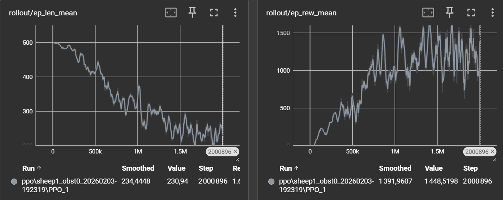
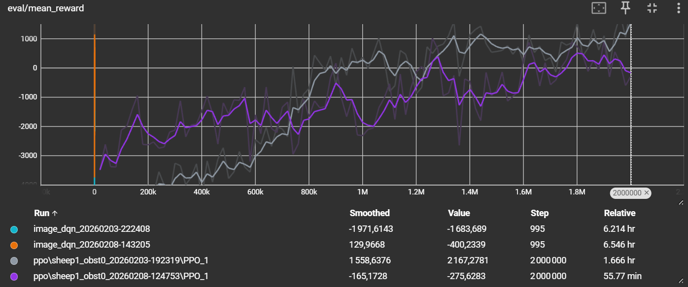

<picture><source media="(prefers-color-scheme: dark)" srcset="https://raw.githubusercontent.com/ThibPltt/ThibPltt/main/assets/repos/Shepherding-dark.svg"><source media="(prefers-color-scheme: light)" srcset="https://raw.githubusercontent.com/ThibPltt/ThibPltt/main/assets/repos/Shepherding-light.svg"></picture>

# Shepherding

Reinforcement learning for a herding task: a shepherd agent learns to push sheep into a goal area.

| At a glance | |
|---|---|
| **Dates** | 2026 |
| **Context** | multi-agent reinforcement learning · solo course project · ENSIM / Le Mans Université |
| **Technologies** | Python · PyTorch · Stable-Baselines3 · Gym · Pygame |
| **Subject** | [Reinforcement Learning for Multi-Agent Shepherding.pdf](Reinforcement%20Learning%20for%20Multi-Agent%20Shepherding.pdf) |

## Problem

In a 2D continuous world, a shepherd must herd sheep into a goal area, first standing still, then moving, then around an obstacle: a classic multi-agent control task where the scripted solution is easy to write but hard for a learning agent to match.

## Role

Solo course project, ENSIM / Le Mans Université, 5th year.

## Decisions

- Build a Gym environment with Pygame rendering, where sheep react to the shepherd through repulsive forces.
- Compare four learning algorithms (PPO, DQN, SAC, TD3) with three scripted shepherds (*lazy*, *tipsy*, *rule-based*), all on the same 500 test episodes.
- Train through a curriculum of three levels, each one starting from the checkpoint of the previous level, and compare it with training from scratch.

## Result

The hand-written rule-based shepherd remains the reference (100 % success on levels 1 and 2). Among the learned agents, PPO transfers best: trained on level 1 only, it solves 78 % of the level-3 episodes, against 33 % when trained directly on level 3.

## Environment (`rl_shepherd/envs/shepherd_env.py`)

- **Action:** the shepherd's heading, continuous in [-1, 1].
- **Observation:** for each sheep its position relative to the shepherd and to the goal, plus the goal and the obstacle relative to the shepherd.
- **Reward:** progress of the flock towards the goal, approach of the target sheep, bonuses when sheep are safe or the episode is solved, penalties for idling and time.

## Agents

- **Learned:** PPO, SAC and TD3 (Stable-Baselines3), and a DQN with an MLP Q-network written in PyTorch (`agents/MLP_QN.py`).
- **Scripted baselines:** *lazy*, *tipsy* and *rule-based* shepherds (`agents/rule_based_agent.py`).
- **Levels:** 1, sheep standing still; 2, moving sheep; 3, an obstacle in the field.

## Results (500 test episodes, 1 sheep, success rate)

| Agent | Level 1 | Level 2 | Level 3 |
|---|---|---|---|
| Rule-based | 1.00 | 1.00 | 0.84 |
| Lazy | 0.02 | 0.33 | 0.33 |
| Tipsy | – | 0.31 | 0.28 |
| PPO, trained on the level | 0.57 | 0.26 | 0.33 |
| PPO trained on level 1, tested on level 3 | | | 0.78 |

Raw outputs are in `rl_shepherd/logs*_TEST_*.txt`, training curves in TensorBoard (`tensorboard --logdir=rl_shepherd/logs/`).

### Training curves (TensorBoard)


<sub>PPO, level 1 (1 sheep): episodes get shorter and the reward rises over 2 million steps.</sub>


<sub>Level 2: evaluation reward of two PPO runs (2 million steps) and two image-based DQN runs.</sub>

## Run it

```bash
cd rl_shepherd
pip install -r requirements.txt

# train: -a algorithm, -s sheep, -g goal radius, -r obstacle radius, -v sheep speed, -c checkpoint
python train.py -a ppo -s 1 -g 0.7 -r 0

# evaluate: -t agent type (ruleBase, lazy, tipsy, PPO, DQN, TD3, SAC), -a model path, -n episodes
python test.py -t ruleBase -n 500 -s 1
python test.py -t PPO -a models/ppo_sheep1_obst0_LEVEL1.zip -n 500 -s 1
```

**Author:** Thibaut Platet · ENSIM
